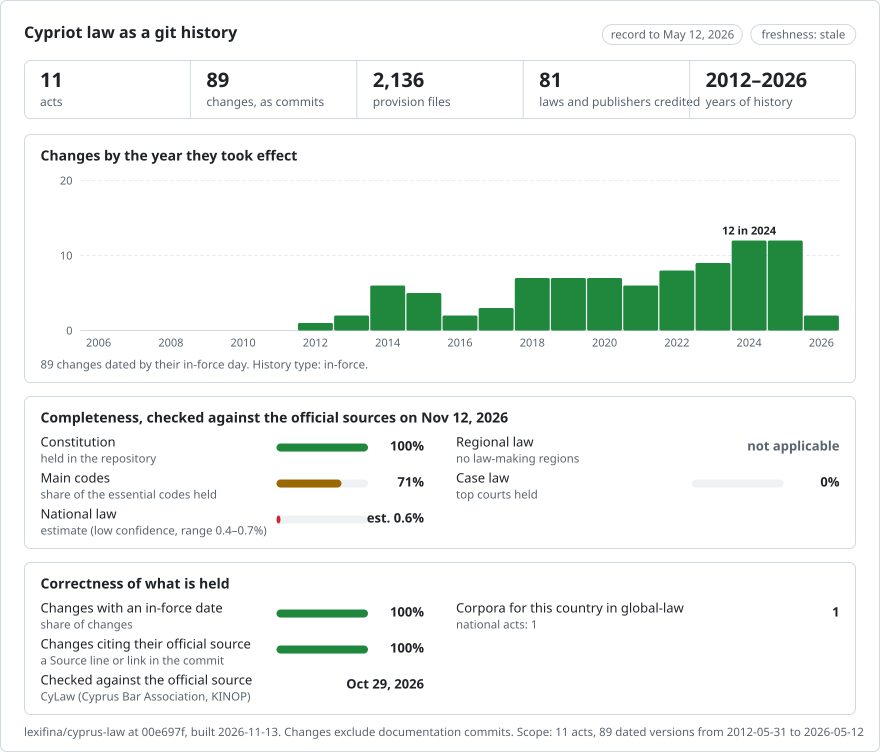

# Cyprus: law history in git

**English** · **[Ή διαβάστε το στα ελληνικά](README.md)**

<picture>
<source media="(prefers-color-scheme: dark)" srcset="data/effort-dark.svg">

</picture>

The law of Cyprus as a git history: one file per article or section, one commit per law on the day it took effect, and the law that made each change as the commit's author. `git blame` names the law behind every paragraph; `git log` lists every change to an article; picking a date gives the text in force that day.

Part of [lexifina/global-law](https://github.com/lexifina/global-law), one git history for every country's law: this is Cyprus's national law, which global-law reads at `cyprus/national/acts/`.

**What is in it now:** 11 acts from CyLaw, with 86 versions: the Constitution (`syntagma/`, 15 versions); the Criminal Code, Cap. 154 (`poinikos-kodikas/`, 15); the Criminal Procedure Law, Cap. 155 (`poiniki-dikonomia/`, 10); the Civil Procedure Law, Cap. 6 (`politiki-dikonomia/`, 8); the Civil Wrongs Law, Cap. 148 (`astika-adikimata/`, 1); the Companies Law, Cap. 113 (`etaireies/`, 1); the Courts of Justice Law 14/1960 (`dikastiria-14-1960/`, 8); the Civil Registry Law 141(I)/2002 (`archeio-plithysmou/`, 16); the Hotels and Tourist Accommodation Law 34(I)/2019 (`xenodocheia/`, 9); the Municipalities Law 52(I)/2022 (`dimoi/`, 1); and the data protection law 125(I)/2018 (`prostasia-dedomenon/`, 2). Each act's folder has a README listing its versions.

Each article or section is one file in its act's folder, `art-<number>.md` (`syntagma/art-146.md` is Article 146 of the Constitution, recourse against administrative acts); the Constitution's annexes are `annex-<nn>.md`.

The text is in Greek, as CyLaw publishes it. An English translation is not part of this record.

## Questions as git commands

| Question | Command |
| --- | --- |
| Every change to Article 146 of the Constitution | `git log -p --word-diff -- syntagma/art-146.md` |
| Which law wrote each line of Article 146? | `git blame syntagma/art-146.md` |
| Every version of Article 146, with the day each took effect | `git log --format="%h %(trailers:key=In-force,valueonly,separator=) %an" -- syntagma/art-146.md` |
| Article 146 as in force on 1 January 2016 | `python tools/on.py 2016-01-01 syntagma art-146` |

**Outside git**, we also host this record publicly, for free:

- **[Ask Claude about Cypriot law](https://global-law.lexifina.com/v1/try_claude?country=cyprus)**: opens Claude with a first question ready.
- **[Ask ChatGPT](https://global-law.lexifina.com/v1/try_chatgpt?country=cyprus)**: the same question in ChatGPT.
- **[Call the API in your browser](https://global-law.lexifina.com/v1/search_law?query=%CE%B4%CE%B5%CE%B4%CE%BF%CE%BC%CE%AD%CE%BD%CE%B1+%CF%80%CF%81%CE%BF%CF%83%CF%89%CF%80%CE%B9%CE%BA%CE%BF%CF%8D+%CF%87%CE%B1%CF%81%CE%B1%CE%BA%CF%84%CE%AE%CF%81%CE%B1&jurisdictions=cyprus)**: a search of Cypriot law for "δεδομένα προσωπικού χαρακτήρα" (personal data), returned as JSON. See the [documentation here](https://lexifina.com/api/global-law).

Both assistants read the record through the free Global law connector (MCP, `https://global-law.lexifina.com/mcp`); the first time, the chat gives you the link that adds it. Ask in Greek or in English.

**Host it yourself easily.** All it takes is git and Python, and the tools run on your machine:

```sh
git clone --depth 1 https://github.com/lexifina/global-law && cd global-law
python3 tools/countries.py add cyprus/national/acts
python3 tools/law.py show 2026-01-01 cyprus/national/acts/syntagma/art-146.md
```

Opened in Claude Code, Cursor, VS Code or Codex, the clone also starts a local MCP server with the same tools ([MCP.md](https://github.com/lexifina/global-law/blob/main/MCP.md)).

## Dates

Each commit is dated at noon, Asia/Nicosia, on the day the version took effect, and carries it in its `In-force:` trailer:

- under the Interpretation Law, Cap. 1, s. 7, a law takes effect on the day it is published in the Official Gazette unless it provides otherwise, so each law is dated by its Gazette issue: as the Gazette extract CyLaw files prints it, or, for 15 laws whose extract is not archived, from the issue itself in the Government Printing Office's archive;
- where a law sets its own day, that day is used: 134(I)/2020 (Cap. 154) from 2020-10-01, and 67(I)/2025 (Constitution, Art. 63) from 2027-07-01, which waits on the branch `mellon` until then;
- 103(I)/2022 (Constitution) is dated by its publication, 2022-07-12, although its s. 7 defers Art. 144 para. 1(3) and (4) and the repeal of Art. 155(2) until the courts concerned begin to sit; those days are not in the sources.

Each change is credited to the law that made it (`Ν. 130(I)/2025`), with an e-mail address that cannot exist (`n-2025-130-i@cylaw.invalid`); the committer is Lexifina. The first version of an act is credited to CyLaw as the oldest version available, except 34(I)/2019 and 125(I)/2018, which are here from their enactment.

## How it is checked

- Every version is read back from git on the day it took effect and on the day before (`tools/check_repo.py`), and must match the corpus: 86 versions, no mismatch. Results are in [`REPRODUCE.md`](REPRODUCE.md).
- Every archived copy of a consolidated CyLaw page is compared, section by section, with the version rebuilt for the same list of laws; where CyLaw later corrected its own transcription, the newest wording is used. The last version of each act equals the newest archived consolidated page.
- Typesetting is normalised in the same way for every source (spaces, quotes, dashes, Latin look-alike letters inside Greek words); the wording is not changed.
- History is append-only: no merge commits, no commit dates going backwards, no commit dated after the build, and every commit's trailers parse.

## What it does not show

- **Most of Cypriot law.** The completeness chart above estimates the national law held here at about 0.6%. There is no case law, subsidiary legislation or bills.
- **Earlier versions.** Each history starts with the oldest version whose laws can all be dated (the Constitution in 2013, Cap. 154 in 2017, Cap. 155 and Cap. 6 in 2014, Law 141(I)/2002 in 2013, Law 14/1960 in 2022), and Cap. 148, Cap. 113 and Law 52(I)/2022 have only one text. Most laws of 1960-2021 have no Gazette day in the online sources (CyLaw's PDFs of them are mostly retyped without the Gazette header, and the Printing Office's online archive has no laws annex for those years), and some old wordings are not archived. `REPRODUCE.md` names, act by act, the laws with no sourced day.
- **The Constitution before 2013.** The 1960 text and the versions of 1990, 1996 and 2002 are on CyLaw, but the day the 1960 Constitution took effect, and the days of 127(I)/2006 and 51(I)/2010, are not in the sources.
- **Part headings, CyLaw's editorial notes (Σημείωση)** and footnotes quoting transitional provisions of amending laws, and the deleted sections ("[Διαγράφηκε]") CyLaw keeps beside later sections of the same number.

## Sources

| Source | Kind | Past versions | Notes |
| --- | --- | --- | --- |
| [CyLaw](https://www.cylaw.org) (Cyprus Bar Association, run by KINOP) | Consolidated legislation, listing under each section the laws that made or amended it | yes, rebuilt section by section from those lists and from archived copies of earlier consolidated pages | Read only from [Internet Archive](https://web.archive.org) copies, each pinned by capture time in `tools/sources.json` |
| [Official Gazette](https://www.mof.gov.cy/gpo) (Επίσημη Εφημερίδα της Δημοκρατίας), Government Printing Office | Gazette issues | as published | The day each law was published; read from the issue itself for 15 laws |

## Licence

See [`LICENSE`](LICENSE). CyLaw's [terms](https://www.cylaw.org/terms.html) let legislation on the site be copied, printed and used free of charge provided CyLaw is named as the source; they need its written consent for bulk or automated downloading, so no page was downloaded from cylaw.org: every page was read from an Internet Archive copy. Neither CyLaw, KINOP nor the Cyprus Bar Association endorses this repository.

No AI model wrote, translated or corrected legal text; the scripts were written by an AI model, and no model runs when the history is built (see [`REPRODUCE.md`](REPRODUCE.md)).

## More

From [lexifina/global-law](https://github.com/lexifina/global-law):

- [FEATURES.md](https://github.com/lexifina/global-law/blob/main/FEATURES.md): every feature, and what every corpus must support (`git blame`, `law.py`, the MCP tools)
- [FAQ.md](https://github.com/lexifina/global-law/blob/main/FAQ.md): questions and answers · [CONTRIBUTING.md](https://github.com/lexifina/global-law/blob/main/CONTRIBUTING.md): proposing changes · [MCP.md](https://github.com/lexifina/global-law/blob/main/MCP.md): the MCP server · [REPRODUCE.md](https://github.com/lexifina/global-law/blob/main/REPRODUCE.md): how it was built · [CHANGELOG.md](https://github.com/lexifina/global-law/blob/main/CHANGELOG.md)
- [FRESHNESS.md](https://github.com/lexifina/global-law/blob/main/FRESHNESS.md): how current each corpus is · [Monitoring](https://github.com/lexifina/global-law/tree/main/monitoring): whether updates are running · [WATCHING.md](https://github.com/lexifina/global-law/blob/main/WATCHING.md): how each official source is watched for changes
- [performance/](https://github.com/lexifina/global-law/tree/main/performance): how fast the tools are, measured
- [visualisations/](https://github.com/lexifina/global-law/tree/main/visualisations): charts and bridges across the world's law
- [Vulnerabilities](https://github.com/lexifina/global-law/tree/main/vulnerabilities): mistakes in legislation as published
