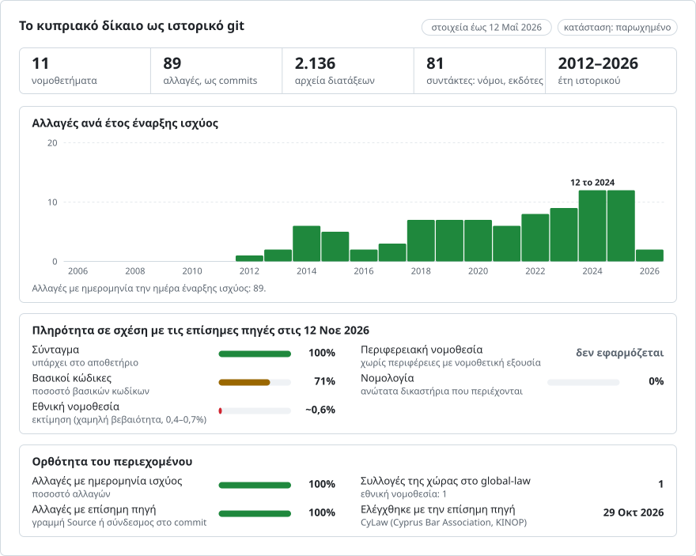

# Κύπρος: η ιστορία του δικαίου σε git

**Ελληνικά** · **[Or read it in English](README.en.md)**

<picture>
<source media="(prefers-color-scheme: dark)" srcset="data/el/effort-dark.svg">

</picture>

Το δίκαιο της Κύπρου ως ιστορία git: ένα αρχείο ανά άρθρο, ένα commit ανά νόμο την ημέρα που τέθηκε σε ισχύ, και ως συντάκτης κάθε commit ο νόμος που επέφερε τη μεταβολή. Το `git blame` κατονομάζει τον νόμο πίσω από κάθε παράγραφο· το `git log` απαριθμεί κάθε μεταβολή ενός άρθρου· η επιλογή μιας ημερομηνίας δίνει το κείμενο που ίσχυε εκείνη την ημέρα.

Μέρος του [lexifina/global-law](https://github.com/lexifina/global-law), μιας ενιαίας ιστορίας git για το δίκαιο κάθε χώρας: εδώ βρίσκεται το εθνικό δίκαιο της Κύπρου, το οποίο το global-law διαβάζει στο `cyprus/national/acts/`.

**Τι περιέχει σήμερα:** 11 νομοθετήματα από το CyLaw, με 86 εκδόσεις: το Σύνταγμα (`syntagma/`, 15 εκδόσεις)· τον περί Ποινικού Κώδικα Νόμο, ΚΕΦ.154 (`poinikos-kodikas/`, 15)· τον περί Ποινικής Δικονομίας Νόμο, ΚΕΦ.155 (`poiniki-dikonomia/`, 10)· τον περί Πολιτικής Δικονομίας Νόμο, ΚΕΦ.6 (`politiki-dikonomia/`, 8)· τον περί Αστικών Αδικημάτων Νόμο, ΚΕΦ.148 (`astika-adikimata/`, 1)· τον περί Εταιρειών Νόμο, ΚΕΦ.113 (`etaireies/`, 1)· τον περί Δικαστηρίων Νόμο του 1960, Ν. 14/1960 (`dikastiria-14-1960/`, 8)· τον περί Αρχείου Πληθυσμού Νόμο του 2002, Ν. 141(I)/2002 (`archeio-plithysmou/`, 16)· τον περί Ξενοδοχείων και Τουριστικών Καταλυμάτων Νόμο, Ν. 34(I)/2019 (`xenodocheia/`, 9)· τον περί Δήμων Νόμο του 2022, Ν. 52(I)/2022 (`dimoi/`, 1)· και τον νόμο για την προστασία των δεδομένων προσωπικού χαρακτήρα, Ν. 125(I)/2018 (`prostasia-dedomenon/`, 2). Ο φάκελος κάθε νομοθετήματος έχει ένα README με τον κατάλογο των εκδόσεών του.

Κάθε άρθρο είναι ένα αρχείο στον φάκελο του νομοθετήματός του, `art-<αριθμός>.md` (το `syntagma/art-146.md` είναι το Άρθρο 146 του Συντάγματος, η προσφυγή κατά διοικητικών πράξεων)· τα παραρτήματα του Συντάγματος είναι τα `annex-<nn>.md`.

Το κείμενο είναι στα ελληνικά, όπως το δημοσιεύει το CyLaw. Μετάφραση στα αγγλικά δεν αποτελεί μέρος αυτού του αρχείου.

## Ερωτήσεις ως εντολές git

| Ερώτηση | Εντολή |
| --- | --- |
| Κάθε μεταβολή του Άρθρου 146 του Συντάγματος | `git log -p --word-diff -- syntagma/art-146.md` |
| Ποιος νόμος έγραψε κάθε γραμμή του Άρθρου 146; | `git blame syntagma/art-146.md` |
| Κάθε έκδοση του Άρθρου 146, με την ημέρα που τέθηκε σε ισχύ | `git log --format="%h %(trailers:key=In-force,valueonly,separator=) %an" -- syntagma/art-146.md` |
| Το Άρθρο 146 όπως ίσχυε την 1η Ιανουαρίου 2016 | `python tools/on.py 2016-01-01 syntagma art-146` |

**Εκτός git** διαθέτουμε επίσης το αρχείο δημόσια και δωρεάν:

- **[Ρωτήστε το Claude για το κυπριακό δίκαιο](https://global-law.lexifina.com/v1/try_claude?country=cyprus)**: ανοίγει το Claude με έτοιμη την πρώτη ερώτηση.
- **[Ρωτήστε το ChatGPT](https://global-law.lexifina.com/v1/try_chatgpt?country=cyprus)**: η ίδια ερώτηση στο ChatGPT.
- **[Καλέστε το API στον φυλλομετρητή](https://global-law.lexifina.com/v1/search_law?query=%CE%B4%CE%B5%CE%B4%CE%BF%CE%BC%CE%AD%CE%BD%CE%B1+%CF%80%CF%81%CE%BF%CF%83%CF%89%CF%80%CE%B9%CE%BA%CE%BF%CF%8D+%CF%87%CE%B1%CF%81%CE%B1%CE%BA%CF%84%CE%AE%CF%81%CE%B1&jurisdictions=cyprus)**: αναζήτηση στο κυπριακό δίκαιο για «δεδομένα προσωπικού χαρακτήρα», με απάντηση σε JSON. Η τεκμηρίωση είναι [εδώ](https://lexifina.com/api/global-law).

Και οι δύο βοηθοί διαβάζουν το αρχείο μέσω του δωρεάν συνδέσμου Global law (MCP, `https://global-law.lexifina.com/mcp`)· την πρώτη φορά η συνομιλία σάς δίνει τον σύνδεσμο που τον προσθέτει. Ρωτήστε στα ελληνικά ή στα αγγλικά.

**Εύκολα και στον δικό σας υπολογιστή.** Αρκούν το git και η Python, και τα εργαλεία τρέχουν τοπικά:

```sh
git clone --depth 1 https://github.com/lexifina/global-law && cd global-law
python3 tools/countries.py add cyprus/national/acts
python3 tools/law.py show 2026-01-01 cyprus/national/acts/syntagma/art-146.md
```

Όταν ανοίγει σε Claude Code, Cursor, VS Code ή Codex, ο κλώνος ξεκινά και έναν τοπικό διακομιστή MCP με τα ίδια εργαλεία ([MCP.md](https://github.com/lexifina/global-law/blob/main/MCP.md)).

## Ημερομηνίες

Κάθε commit φέρει ημερομηνία στις 12:00, ώρα Asia/Nicosia, την ημέρα που η έκδοση τέθηκε σε ισχύ, και την ημέρα αυτή στο trailer `In-force:`:

- σύμφωνα με τον περί Ερμηνείας Νόμο, ΚΕΦ.1, άρθρο 7, ένας νόμος τίθεται σε ισχύ την ημέρα της δημοσίευσής του στην Επίσημη Εφημερίδα, εκτός αν ορίζει διαφορετικά· γι' αυτό κάθε νόμος χρονολογείται από το φύλλο της Εφημερίδας στο οποίο δημοσιεύθηκε, όπως το τυπώνει το απόσπασμα της Εφημερίδας που καταχωρίζει το CyLaw ή, για 15 νόμους των οποίων το απόσπασμα δεν είναι αρχειοθετημένο, από το ίδιο το φύλλο στο αρχείο του Κυβερνητικού Τυπογραφείου·
- όπου ένας νόμος ορίζει δική του ημέρα, χρησιμοποιείται η ημέρα αυτή: ο Ν. 134(I)/2020 (ΚΕΦ.154) από 2020-10-01 και ο Ν. 67(I)/2025 (Σύνταγμα, Άρθρο 63) από 2027-07-01, ο οποίος μέχρι τότε βρίσκεται στον κλάδο `mellon`·
- ο Ν. 103(I)/2022 (Σύνταγμα) χρονολογείται από τη δημοσίευσή του, 2022-07-12, αν και το άρθρο 7 του αναβάλλει το Άρθρο 144 παρ. 1(3) και (4) και την κατάργηση του Άρθρου 155(2) μέχρι να αρχίσουν να λειτουργούν τα οικεία δικαστήρια· οι ημέρες αυτές δεν υπάρχουν στις πηγές.

Κάθε μεταβολή αποδίδεται στον νόμο που την επέφερε (`Ν. 130(I)/2025`), με διεύθυνση e-mail που δεν μπορεί να υπάρχει (`n-2025-130-i@cylaw.invalid`)· ο committer είναι η Lexifina. Η πρώτη έκδοση κάθε νομοθετήματος αποδίδεται στο CyLaw ως η παλαιότερη διαθέσιμη έκδοση, εκτός από τους Ν. 34(I)/2019 και 125(I)/2018, που περιέχονται εδώ από τη θέσπισή τους.

## Πώς ελέγχεται

- Κάθε έκδοση διαβάζεται ξανά από το git την ημέρα που τέθηκε σε ισχύ και την προηγούμενη ημέρα (`tools/check_repo.py`) και πρέπει να συμφωνεί με τη συλλογή κειμένων: 86 εκδόσεις, καμία απόκλιση. Τα αποτελέσματα βρίσκονται στο [`REPRODUCE.md`](REPRODUCE.md).
- Κάθε αρχειοθετημένο αντίγραφο ενοποιημένης σελίδας του CyLaw συγκρίνεται, άρθρο προς άρθρο, με την έκδοση που ανασυντίθεται για τον ίδιο κατάλογο νόμων· όπου το CyLaw διόρθωσε αργότερα τη δική του μεταγραφή, χρησιμοποιείται η νεότερη διατύπωση. Η τελευταία έκδοση κάθε νομοθετήματος είναι ίδια με τη νεότερη αρχειοθετημένη ενοποιημένη σελίδα.
- Η τυπογραφία κανονικοποιείται με τον ίδιο τρόπο για κάθε πηγή (κενά, εισαγωγικά, παύλες, λατινικά γράμματα όμοια με ελληνικά μέσα σε ελληνικές λέξεις)· η διατύπωση δεν αλλάζει.
- Η ιστορία μόνο συμπληρώνεται: κανένα merge commit, καμία ημερομηνία commit που πηγαίνει προς τα πίσω, κανένα commit με ημερομηνία μετά την κατασκευή, και τα trailers κάθε commit είναι ορθής μορφής.

## Τι δεν δείχνει

- **Το μεγαλύτερο μέρος του κυπριακού δικαίου.** Το διάγραμμα πληρότητας παραπάνω υπολογίζει την εθνική νομοθεσία που περιέχεται εδώ σε περίπου 0,6%. Δεν περιέχεται νομολογία, δευτερογενής νομοθεσία ή νομοσχέδια.
- **Τις παλαιότερες εκδόσεις.** Κάθε ιστορία αρχίζει με την παλαιότερη έκδοση της οποίας όλοι οι νόμοι μπορούν να χρονολογηθούν (το Σύνταγμα το 2013, το ΚΕΦ.154 το 2017, τα ΚΕΦ.155 και ΚΕΦ.6 το 2014, ο Ν. 141(I)/2002 το 2013, ο Ν. 14/1960 το 2022), και τα ΚΕΦ.148, ΚΕΦ.113 και ο Ν. 52(I)/2022 έχουν μόνο ένα κείμενο. Οι περισσότεροι νόμοι της περιόδου 1960-2021 δεν έχουν ημέρα δημοσίευσης στις διαδικτυακές πηγές (τα PDF του CyLaw γι' αυτούς είναι κυρίως κείμενα πληκτρολογημένα εκ νέου, χωρίς την κεφαλίδα της Εφημερίδας, και το διαδικτυακό αρχείο του Τυπογραφείου δεν έχει παράρτημα νόμων για τα έτη αυτά), και ορισμένες παλαιές διατυπώσεις δεν είναι αρχειοθετημένες. Το `REPRODUCE.md` κατονομάζει, ανά νομοθέτημα, τους νόμους χωρίς τεκμηριωμένη ημέρα.
- **Το Σύνταγμα πριν από το 2013.** Το κείμενο του 1960 και οι εκδόσεις του 1990, του 1996 και του 2002 υπάρχουν στο CyLaw, αλλά η ημέρα κατά την οποία τέθηκε σε ισχύ το Σύνταγμα του 1960, καθώς και οι ημέρες των Ν. 127(I)/2006 και 51(I)/2010, δεν υπάρχουν στις πηγές.
- **Τις επικεφαλίδες των Μερών, τις συντακτικές σημειώσεις του CyLaw (Σημείωση)** και τις υποσημειώσεις που παραθέτουν μεταβατικές διατάξεις τροποποιητικών νόμων, καθώς και τα διαγραμμένα άρθρα («[Διαγράφηκε]») που το CyLaw διατηρεί δίπλα σε μεταγενέστερα άρθρα με τον ίδιο αριθμό.

## Πηγές

| Πηγή | Είδος | Παλαιότερες εκδόσεις | Σημειώσεις |
| --- | --- | --- | --- |
| [CyLaw](https://www.cylaw.org) (Παγκύπριος Δικηγορικός Σύλλογος, το λειτουργεί το ΚΙΝΟΠ) | Ενοποιημένη νομοθεσία, με τους νόμους που θέσπισαν ή τροποποίησαν κάθε άρθρο κάτω από αυτό | ναι, ανασυντίθενται άρθρο προς άρθρο από αυτούς τους καταλόγους και από αρχειοθετημένα αντίγραφα παλαιότερων ενοποιημένων σελίδων | Διαβάστηκε μόνο από αντίγραφα του [Internet Archive](https://web.archive.org), καθένα προσδιορισμένο με τον χρόνο λήψης του στο `tools/sources.json` |
| [Επίσημη Εφημερίδα της Δημοκρατίας](https://www.mof.gov.cy/gpo), Κυβερνητικό Τυπογραφείο | Φύλλα της Εφημερίδας | όπως δημοσιεύθηκαν | Η ημέρα δημοσίευσης κάθε νόμου· για 15 νόμους διαβάστηκε το ίδιο το φύλλο |

## Άδεια

Βλ. [`LICENSE`](LICENSE). Οι [όροι χρήσης](https://www.cylaw.org/terms.html) του CyLaw επιτρέπουν την αντιγραφή, εκτύπωση και χρήση της νομοθεσίας του ιστότοπου δωρεάν, εφόσον το CyLaw αναφέρεται ως πηγή· για τη μαζική ή αυτοματοποιημένη λήψη απαιτούν τη γραπτή του συγκατάθεση, γι' αυτό καμία σελίδα δεν ανακτήθηκε από το cylaw.org: κάθε σελίδα διαβάστηκε από αντίγραφο του Internet Archive. Ούτε το CyLaw ούτε το ΚΙΝΟΠ ούτε ο Παγκύπριος Δικηγορικός Σύλλογος εγκρίνουν αυτό το αποθετήριο.

Κανένα μοντέλο τεχνητής νοημοσύνης δεν έγραψε, μετέφρασε ή διόρθωσε νομικό κείμενο· τα scripts τα έγραψε ένα μοντέλο τεχνητής νοημοσύνης, και κανένα μοντέλο δεν εκτελείται κατά την κατασκευή της ιστορίας (βλ. [`REPRODUCE.md`](REPRODUCE.md)).

Αυτή είναι μετάφραση της αγγλικής έκδοσης ([README.en.md](README.en.md))· σε περίπτωση διαφοράς, υπερισχύει η αγγλική έκδοση.

## Περισσότερα

Από το αποθετήριο [lexifina/global-law](https://github.com/lexifina/global-law) (στα αγγλικά):

- [FEATURES.md](https://github.com/lexifina/global-law/blob/main/FEATURES.md): όλες οι λειτουργίες και τι πρέπει να υποστηρίζει κάθε συλλογή (`git blame`, `law.py`, εργαλεία MCP)
- [FAQ.md](https://github.com/lexifina/global-law/blob/main/FAQ.md): ερωτήσεις και απαντήσεις · [CONTRIBUTING.md](https://github.com/lexifina/global-law/blob/main/CONTRIBUTING.md): πρόταση αλλαγών · [MCP.md](https://github.com/lexifina/global-law/blob/main/MCP.md): διακομιστής MCP · [REPRODUCE.md](https://github.com/lexifina/global-law/blob/main/REPRODUCE.md): πώς δημιουργήθηκε · [CHANGELOG.md](https://github.com/lexifina/global-law/blob/main/CHANGELOG.md)
- [FRESHNESS.md](https://github.com/lexifina/global-law/blob/main/FRESHNESS.md): πόσο ενημερωμένη είναι κάθε συλλογή · [Παρακολούθηση](https://github.com/lexifina/global-law/tree/main/monitoring): αν οι ενημερώσεις λειτουργούν · [WATCHING.md](https://github.com/lexifina/global-law/blob/main/WATCHING.md): πώς παρακολουθείται κάθε επίσημη πηγή για αλλαγές
- [performance/](https://github.com/lexifina/global-law/tree/main/performance): πόσο γρήγορα είναι τα εργαλεία, με μετρήσεις
- [visualisations/](https://github.com/lexifina/global-law/tree/main/visualisations): γραφήματα και συνδέσεις σε όλο το δίκαιο του κόσμου
- [Ευπάθειες](https://github.com/lexifina/global-law/tree/main/vulnerabilities): σφάλματα στα νομοθετήματα όπως δημοσιεύθηκαν
