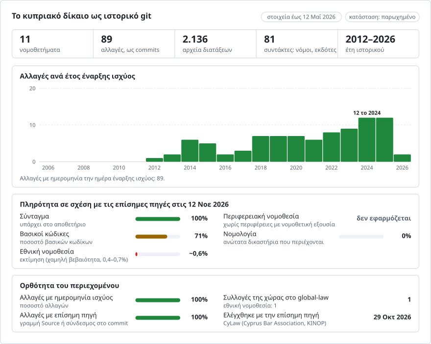

# Κύπρος: η ιστορία του δικαίου σε git

**Ελληνικά** · [English](README.en.md)

<picture>
<source media="(prefers-color-scheme: dark)" srcset="data/el/effort-dark.svg">

</picture>

Μέρος του [lexifina/global-law](https://github.com/lexifina/global-law), μιας ενιαίας ιστορίας git για το δίκαιο κάθε χώρας: εδώ βρίσκεται το εθνικό δίκαιο της Κύπρου, το οποίο το global-law διαβάζει στο `cyprus/national/acts/`.

Το δίκαιο της Κύπρου ως ιστορία git: ένα αρχείο ανά διάταξη, ένα commit ανά νόμο την ημέρα που αυτός τέθηκε σε ισχύ, και ως συντάκτης (author) του commit ο νόμος που επέφερε την αλλαγή. Το `git blame` κατονομάζει τον νόμο πίσω από κάθε παράγραφο· το `git log` απαριθμεί κάθε αλλαγή μιας διάταξης· το `tools/on.py` δίνει το κείμενο που ίσχυε οποιαδήποτε ημέρα.

Ακολουθεί τον κοινό σχεδιασμό του [lexifina/global-law](https://github.com/lexifina/global-law), που το τοποθετεί στο `cy/`. Τα κείμενα είναι στα ελληνικά, την επίσημη γλώσσα στην οποία τα δημοσιεύει το CyLaw.

**Τι περιέχει σήμερα**

| Φάκελος | Νομοθέτημα | Εκδόσεις | Ιστορικό |
| --- | --- | ---: | --- |
| `syntagma/` | Το Σύνταγμα της Κυπριακής Δημοκρατίας | 15 | 2013-07-17 έως 2025-11-07, και 2027-07-01 στο `mellon` |
| `poinikos-kodikas/` | Ο περί Ποινικού Κώδικα Νόμος, ΚΕΦ.154 | 15 | 2017-04-07 έως 2025-12-12 |
| `poiniki-dikonomia/` | Ο περί Ποινικής Δικονομίας Νόμος, ΚΕΦ.155 | 10 | 2014-02-21 έως 2025-12-19 |
| `astika-adikimata/` | Ο περί Αστικών Αδικημάτων Νόμος, ΚΕΦ.148 | 1 | 2012-05-31 (το κείμενο όπως τροποποιήθηκε τελευταία, με τον Ν. 66(I)/2012) |
| `etaireies/` | Ο περί Εταιρειών Νόμος, ΚΕΦ.113 | 1 | 2026-02-06 (το κείμενο όπως τροποποιήθηκε τελευταία, με τον Ν. 2(I)/2026) |
| `politiki-dikonomia/` | Ο περί Πολιτικής Δικονομίας Νόμος, ΚΕΦ.6 | 8 | 2014-05-23 έως 2025-07-22 |
| `dikastiria-14-1960/` | Ο περί Δικαστηρίων Νόμος του 1960 (Ν. 14/1960) | 8 | 2022-06-02 έως 2026-05-12 |
| `archeio-plithysmou/` | Ο περί Αρχείου Πληθυσμού Νόμος του 2002 (Ν. 141(I)/2002) | 16 | 2013-12-27 έως 2025-12-12 |
| `xenodocheia/` | Ο περί Ξενοδοχείων και Τουριστικών Καταλυμάτων Νόμος (Ν. 34(I)/2019) | 9 | 2019-03-15 (όπως θεσπίστηκε) έως 2025-10-24 |
| `dimoi/` | Ο περί Δήμων Νόμος του 2022 (Ν. 52(I)/2022) | 1 | 2025-10-17 (το κείμενο όπως τροποποιήθηκε τελευταία, με τον Ν. 177(I)/2025) |
| `prostasia-dedomenon/` | Ο Νόμος 125(I)/2018 για την προστασία των φυσικών προσώπων έναντι της επεξεργασίας των δεδομένων προσωπικού χαρακτήρα (ο νόμος εφαρμογής του ΓΚΠΔ) | 2 | 2018-07-31 (όπως θεσπίστηκε) έως 2022-03-11 |

Κάθε φάκελος νομοθετήματος έχει ένα README με τον κατάλογο των εκδόσεών του.

## Πηγές

- Το **CyLaw** (cylaw.org), η υπηρεσία νομικής πληροφόρησης του Παγκύπριου Δικηγορικού Συλλόγου, την οποία λειτουργεί το ΚΙΝΟΠ, δημοσιεύει κάθε νομοθέτημα σε ενοποιημένη μορφή. Κάτω από κάθε άρθρο απαριθμεί τους νόμους που το θέσπισαν ή το τροποποίησαν, από τον παλαιότερο, και για καθέναν παραπέμπει στη διατύπωση του άρθρου όπως την άφησε ο νόμος αυτός. Έτσι το νομοθέτημα οποιασδήποτε ημέρας ανασυντίθεται άρθρο προς άρθρο: κάθε άρθρο έχει τη διατύπωση που του έδωσε ο τελευταίος από τους νόμους του που ίσχυαν εκείνη την ημέρα.
- Οι όροι χρήσης του CyLaw επιτρέπουν την ελεύθερη αντιγραφή με αναφορά του CyLaw ως πηγής, αλλά η μαζική ή αυτοματοποιημένη λήψη από τον ιστότοπο απαιτεί τη γραπτή συγκατάθεσή του. Γι' αυτό **καμία σελίδα δεν ανακτήθηκε από το cylaw.org**: κάθε σελίδα και κάθε PDF του CyLaw είναι αντίγραφο του Internet Archive, προσδιορισμένο με τον χρόνο λήψης του στο `tools/sources.json`.
- Η νεότερη αρχειοθετημένη ενοποιημένη σελίδα δίνει το σημερινό κείμενο. Οι παλαιότερες διατυπώσεις προέρχονται από αρχειοθετημένες σελίδες ανά άρθρο και από αρχειοθετημένα αντίγραφα ολόκληρης της ενοποιημένης σελίδας από προηγούμενα έτη (21 για το Σύνταγμα από το 2013, 27 για το ΚΕΦ.154 από το 2012, 3 για τον Ν. 125(I)/2018, 4 για το ΚΕΦ.155 από το 2022, 2 για το ΚΕΦ.148, 3 για το ΚΕΦ.113, 4 για το ΚΕΦ.6).
- Οι **ημερομηνίες** προέρχονται από την Επίσημη Εφημερίδα της Δημοκρατίας. Για τους περισσότερους νόμους, το απόσπασμα της Εφημερίδας που καταχωρίζει το CyLaw (`/nomoi/arith/<year>_1_<number>.pdf`, αρχειοθετημένο αντίγραφο) δίνει τον αριθμό και την ημερομηνία του φύλλου στο δικό του επίπεδο κειμένου. Για τους Ν. 186(I)/2025 και 212(I)/2025, των οποίων τα αποσπάσματα δεν είναι αρχειοθετημένα, διαβάστηκε το ίδιο το φύλλο της Εφημερίδας από το αρχείο του Κυβερνητικού Τυπογραφείου (mof.gov.cy/gpo). Δεν γίνεται OCR.

## Τι λείπει

- **Σύνταγμα πριν από τις 2013-07-17.** Το κείμενο του 1960 και οι εκδόσεις της 1990-01-01 (95/1989), του 1996 (106(I)/1996, 115(I)/1996) και του 2002 (104(I)/2002) υπάρχουν πλήρεις στο CyLaw, αλλά παραλείπονται επειδή οι ημερομηνίες τους δεν μπορούν να τεκμηριωθούν:
  - οι πηγές μας δεν αναφέρουν την ημέρα κατά την οποία τέθηκε σε ισχύ το Σύνταγμα του 1960·
  - για τους Ν. 127(I)/2006 και 51(I)/2010, τα PDF του CyLaw είναι κείμενα πληκτρολογημένα εκ νέου, χωρίς την κεφαλίδα της Εφημερίδας, και το διαδικτυακό αρχείο του Τυπογραφείου δεν έχει παράρτημα νόμων για τα έτη αυτά. Χωρίς αυτά, οι αλλαγές που έγιναν μεταξύ 2002 και 2013 δεν μπορούν να χρονολογηθούν, γι' αυτό η ιστορία αρχίζει με την έκδοση που ίσχυε μετά τον Ν. 68(I)/2013, η οποία αποδίδεται στο CyLaw ως η παλαιότερη διαθέσιμη έκδοση.
- **Σύνταγμα, Ν. 103(I)/2022.** Το άρθρο 7 του νόμου ορίζει την έναρξη της ισχύος του από τη δημοσίευσή του, εκτός από το Άρθρο 144 παρ. 1(3) και (4) και την κατάργηση του Άρθρου 155(2), που αρχίζουν να ισχύουν όταν τα οικεία δικαστήρια αρχίσουν να λειτουργούν, όπως προβλέπουν άλλοι νόμοι. Οι ημέρες αυτές δεν υπάρχουν στις πηγές μας, γι' αυτό οι αλλαγές αυτές εμφανίζονται από τη δημοσίευση (2022-07-12).
- **ΚΕΦ.154 πριν από τις 2017-04-07.** Το CyLaw απαριθμεί 85 τροποποιητικές πράξεις από το 1962. 36 από αυτές (πέντε της περιόδου 1962–1965, 29 της περιόδου 1999–2012 και ο Ν. 43(I)/2016) και μία ανακοίνωση (ΑΝΑΚ.3309) δεν έχουν τεκμηριωμένη ημερομηνία: τα περισσότερα PDF του CyLaw γι' αυτές είναι κείμενα πληκτρολογημένα εκ νέου, χωρίς την κεφαλίδα της Εφημερίδας, τα επίπεδα κειμένου των αποσπασμάτων του 1962–1965 δεν δείχνουν ημερομηνία, το PDF του Ν. 43(I)/2016 έχει μη αναγνώσιμο επίπεδο κειμένου, και το διαδικτυακό αρχείο του Τυπογραφείου δεν έχει παράρτημα νόμων για τα έτη αυτά. Η ιστορία επομένως αρχίζει με την έκδοση που ίσχυε μετά τον Ν. 31(I)/2017, ως η παλαιότερη διαθέσιμη έκδοση.
- **ΚΕΦ.155 πριν από τις 2014-02-21.** Το CyLaw απαριθμεί 33 τροποποιητικές πράξεις από το 1972. 13 από αυτές (το αρχικό κείμενο, ο Ν. 93/1972, η ΑΝΑΚ.3374 και κάθε νόμος από τον 14(I)/2001 έως τον 23(I)/2013) δεν έχουν τεκμηριωμένη ημερομηνία: τα PDF του CyLaw γι' αυτές είναι κείμενα πληκτρολογημένα εκ νέου, χωρίς την κεφαλίδα της Εφημερίδας, και το διαδικτυακό αρχείο του Τυπογραφείου δεν έχει παράρτημα νόμων για τα έτη αυτά· επιπλέον, η αρχική διατύπωση 22 άρθρων δεν είναι αρχειοθετημένη. Η ιστορία επομένως αρχίζει με την έκδοση που ίσχυε μετά τον Ν. 16(I)/2014. Ο Ν. 235(I)/2025 χρονολογείται από το φύλλο της Εφημερίδας στο οποίο δημοσιεύθηκε (Αρ. 5067, 19.12.2025). Το CyLaw διατηρεί τα διαγραμμένα παλαιότερα άρθρα 92, 93, 94 και 155 («[Διαγράφηκε]») δίπλα στα μεταγενέστερα άρθρα με τους ίδιους αριθμούς· τα διαγραμμένα παραλείπονται.
- **ΚΕΦ.148 πριν από τις 2012-05-31.** Πέντε από τους τροποποιητικούς νόμους του και μία ανακοίνωση (154(I)/2002, 129(I)/2006, 171(I)/2006, 82(I)/2008, ΑΝΑΚ.3309) δεν έχουν τεκμηριωμένη ημερομηνία, γι' αυτό δίνεται μόνο το κείμενο όπως τροποποιήθηκε τελευταία, με τον Ν. 66(I)/2012, ως η παλαιότερη διαθέσιμη έκδοση.
- **ΚΕΦ.113 πριν από τις 2026-02-06.** Οι περισσότεροι από τους νόμους που απαριθμεί το CyLaw από το 2000 έως το 2021 δεν έχουν τεκμηριωμένη ημερομηνία (αποσπάσματα πληκτρολογημένα εκ νέου, χωρίς διαδικτυακό παράρτημα νόμων για τα έτη αυτά), και η διατύπωση του άρθρου 2 όπως την άφησε ο Ν. 162(I)/2025 δεν είναι αρχειοθετημένη, γι' αυτό δίνεται μόνο το κείμενο όπως τροποποιήθηκε τελευταία, με τον Ν. 2(I)/2026 (Εφημερίδα Αρ. 5071, 6.2.2026), ως η παλαιότερη διαθέσιμη έκδοση. Το CyLaw παραθέτει τα άρθρα 157ΙΑ-157ΙΔ δύο φορές με το ίδιο κείμενο· χρησιμοποιείται το ένα από τα δύο.
- **ΚΕΦ.6 πριν από τις 2014-05-23.** Το αρχικό κείμενο, οι Ν. 14/1960 και 11/1965, η ΑΝΑΚ.3374 και οι Ν. 58(I)/2003, 66(I)/2004 και 138(I)/2006 δεν έχουν τεκμηριωμένη ημερομηνία, γι' αυτό η ιστορία αρχίζει μετά τον επόμενο χρονολογημένο νόμο.
- **Ν. 14/1960 πριν από τις 2022-06-02, Ν. 141(I)/2002 πριν από τις 2013-12-27 και Ν. 52(I)/2022 πριν από τις 2025-10-17.** Οι παλαιότερες εκδόσεις απαιτούν ημέρες δημοσίευσης στην Εφημερίδα που οι διαδικτυακές πηγές δεν δίνουν (για τους περισσότερους νόμους της περιόδου 1960-2021) ή παλαιές διατυπώσεις που κανένα από τα δύο αρχεία δεν διαθέτει (το άρθρο 22Β του Ν. 14/1960· 32 άρθρα του Ν. 52(I)/2022), γι' αυτό οι ιστορίες αρχίζουν αργότερα. Ο Ν. 34(I)/2019 είναι πλήρης από τη θέσπισή του.
- Οι επικεφαλίδες των Μερών, οι συντακτικές σημειώσεις του CyLaw (Σημείωση) και οι υποσημειώσεις που παραθέτουν μεταβατικές διατάξεις τροποποιητικών νόμων παραλείπονται.

## Ημερομηνίες

- Κάθε commit χρονολογείται στις **12:00 το μεσημέρι, ώρα Asia/Nicosia, την ημέρα που η αλλαγή τέθηκε σε ισχύ**· η ημέρα αναγράφεται επίσης στο trailer `In-force:`, το οποίο διαβάζουν τα εργαλεία.
- Σύμφωνα με τον περί Ερμηνείας Νόμο, ΚΕΦ.1, άρθρο 7, ένας νόμος τίθεται σε ισχύ την ημέρα της δημοσίευσής του στην Επίσημη Εφημερίδα, εκτός αν ορίζει διαφορετικά. Κάθε νόμος χρονολογείται από το φύλλο της Εφημερίδας στο οποίο δημοσιεύθηκε. Όπου ένας νόμος ορίζει στο κείμενό του στην Εφημερίδα δική του ημερομηνία έναρξης ισχύος, χρησιμοποιείται η ημέρα αυτή και αναγράφεται στο `REPRODUCE.md`: ο Ν. 134(I)/2020 (ΚΕΦ.154) από 2020-10-01 και ο Ν. 67(I)/2025 (Σύνταγμα, Άρθρο 63) από 2027-07-01.
- Οι εκδόσεις που τίθενται σε ισχύ μετά την ημέρα κατασκευής του αποθετηρίου βρίσκονται στον κλάδο `mellon`. Σήμερα πρόκειται για τον Ν. 67(I)/2025, τον οποίο το ενοποιημένο κείμενο του CyLaw ήδη εμφανίζει.
- Το `--before="YYYY-MM-DD"` μόνο του χρησιμοποιεί την ώρα της ημέρας του ρολογιού σας· χρησιμοποιήστε `T23:59:59Z` ή το εργαλείο.

## Οι ερωτήσεις ενός νομικού ως εντολές git

| Ερώτηση | Εντολή |
| --- | --- |
| Τι όριζε το Άρθρο 146 του Συντάγματος την 1η Ιανουαρίου 2016; | `python tools/on.py 2016-01-01 syntagma art-146` |
| Ποιος νόμος έγραψε κάθε γραμμή; | `git blame poinikos-kodikas/art-145.md` |
| Κάθε αλλαγή, λέξη προς λέξη | `git log -p --word-diff syntagma/art-111.md` |
| Κάθε νόμος της ιστορίας, με τη σειρά | `git log --reverse --format="%ad %an" --date=short main` |
| Όλα όσα άλλαξε ένας νόμος | `git show law/<key>` |

## Πώς ελέγχεται

- Κάθε έκδοση διαβάζεται ξανά από το git την ημέρα που τέθηκε σε ισχύ και την προηγούμενη ημέρα (`tools/check_repo.py`)· και οι δύο πρέπει να συμφωνούν με τη συλλογή κειμένων. Τα αποτελέσματα βρίσκονται στο `REPRODUCE.md`.
- Κάθε αρχειοθετημένο αντίγραφο ενοποιημένης σελίδας συγκρίνεται, άρθρο προς άρθρο, με την έκδοση που ανασυντίθεται από τα ιστορικά του CyLaw για τον ίδιο κατάλογο νόμων. Ν. 125(I)/2018: και τα 3 αντίγραφα συμφωνούν. Σύνταγμα: και τα 21 αντίγραφα συμφωνούν, εκτός από τα σημεία όπου το CyLaw διόρθωσε αργότερα τη δική του μεταγραφή (λέξεις που έλειπαν στα Άρθρα 111, 124, 139 και 153, σε αντίγραφα έως τον Οκτώβριο του 2019) και το Άρθρο 135Α, το οποίο το CyLaw πρόσθεσε στην ενοποίησή του μερικούς μήνες μετά τον Ν. 130(I)/2025. ΚΕΦ.154: κάθε αντίγραφο από τον Ιούνιο του 2013 συμφωνεί, εκτός από μία διόρθωση στο άρθρο 5 («196» συμπληρώθηκε σε «1960»). ΚΕΦ.155: και τα 4 αντίγραφα (2022-2026) συμφωνούν. ΚΕΦ.6: και τα 4 αντίγραφα (2022-2025) συμφωνούν. ΚΕΦ.113: το νεότερο αντίγραφο (Οκτώβριος 2026) συμφωνεί· τα δύο αντίγραφα του 2025 διαφέρουν σε 13 και 34 άρθρα, τα οποία το CyLaw αργότερα διόρθωσε ή ενοποίησε εκ νέου. ΚΕΦ.148: το νεότερο αντίγραφο (Ιούλιος 2026) συμφωνεί· το αντίγραφο του 2022 διαφέρει ως προς τη μεταγραφή του CyLaw σε κάθε άρθρο. Σε κάθε τέτοια περίπτωση χρησιμοποιείται η νεότερη διατύπωση.
- Η τελευταία έκδοση κάθε νομοθετήματος είναι ίδια με τη νεότερη αρχειοθετημένη ενοποιημένη σελίδα, άρθρο προς άρθρο.
- Η τυπογραφία κανονικοποιείται με τον ίδιο τρόπο για κάθε πηγή: κενά, εισαγωγικά, παύλες, τα σύμβολα micro και increment, και λατινικά γράμματα όμοια με ελληνικά που έχουν πληκτρολογηθεί μέσα σε ελληνικές λέξεις (το ίδιο το CyLaw έχει διορθώσει πολλά από αυτά με τα χρόνια).

## Άδεια χρήσης

- Πηγή: CyLaw (https://www.cylaw.org), Παγκύπριος Δικηγορικός Σύλλογος / ΚΙΝΟΠ. Ελεύθερη αντιγραφή και χρήση με αναφορά του CyLaw ως πηγής (cylaw.org/terms.html). Βλ. `LICENSE`.
- Φύλλα της Επίσημης Εφημερίδας από το Κυβερνητικό Τυπογραφείο της Κυπριακής Δημοκρατίας (www.mof.gov.cy/gpo).
- Τα αρχειοθετημένα αντίγραφα προέρχονται από το Internet Archive (https://web.archive.org).

Αυτή είναι μετάφραση της αγγλικής έκδοσης ([README.en.md](README.en.md))· σε περίπτωση διαφοράς, υπερισχύει η αγγλική έκδοση.

## Τι σημαίνει «author»

Συντάκτης (author) ενός commit είναι ο νόμος που επέφερε την αλλαγή, με διεύθυνση e-mail που δεν μπορεί να υπάρχει, ώστε τα `git blame` και `git log --author` να κατονομάζουν νόμους. Ο committer είναι πάντα η Lexifina.

Το αποθετήριο αυτό δεν αποτελεί νομική συμβουλή.

## Περισσότερα

Από το αποθετήριο [lexifina/global-law](https://github.com/lexifina/global-law) (στα αγγλικά):

- [FEATURES.md](https://github.com/lexifina/global-law/blob/main/FEATURES.md): όλες οι λειτουργίες και τι πρέπει να υποστηρίζει κάθε συλλογή (`git blame`, `law.py`, εργαλεία MCP)
- [FAQ.md](https://github.com/lexifina/global-law/blob/main/FAQ.md): ερωτήσεις και απαντήσεις · [CONTRIBUTING.md](https://github.com/lexifina/global-law/blob/main/CONTRIBUTING.md): πρόταση αλλαγών · [MCP.md](https://github.com/lexifina/global-law/blob/main/MCP.md): διακομιστής MCP · [REPRODUCE.md](https://github.com/lexifina/global-law/blob/main/REPRODUCE.md): πώς δημιουργήθηκε · [CHANGELOG.md](https://github.com/lexifina/global-law/blob/main/CHANGELOG.md)
- [FRESHNESS.md](https://github.com/lexifina/global-law/blob/main/FRESHNESS.md): πόσο ενημερωμένη είναι κάθε συλλογή · [Παρακολούθηση](https://github.com/lexifina/global-law/tree/main/monitoring): αν οι ενημερώσεις λειτουργούν · [WATCHING.md](https://github.com/lexifina/global-law/blob/main/WATCHING.md): πώς παρακολουθείται κάθε επίσημη πηγή για αλλαγές
- [performance/](https://github.com/lexifina/global-law/tree/main/performance): πόσο γρήγορα είναι τα εργαλεία, με μετρήσεις
- [visualisations/](https://github.com/lexifina/global-law/tree/main/visualisations): γραφήματα και συνδέσεις σε όλο το δίκαιο του κόσμου
- [Ευπάθειες](https://github.com/lexifina/global-law/tree/main/vulnerabilities): σφάλματα στα νομοθετήματα όπως δημοσιεύθηκαν
